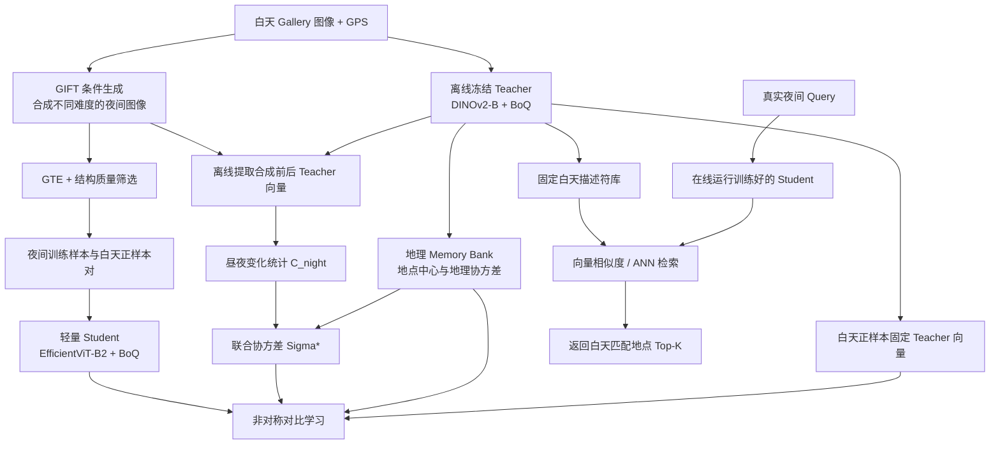

# Night-AsymGIFT：面向夜间查询的轻量级非对称视觉地点识别方案

> **文档性质：研究方案 / 待验证设计（非已发表方法、非实验结果）**  
> **目标任务：** 夜间 Query → 白天 Gallery 的 Visual Place Recognition（VPR）  
> **核心目标：** 尽量复用两篇论文现成的网络与训练机制，用少量改动提升夜间鲁棒性，同时保持在线推理轻量、图库无需逐 Query 重算。

## 0. 一句话概括

**白天用冻结的大模型一次性建库；训练阶段利用 GIFT 生成并筛选“结构保真、难度适中”的夜间图片，再用 Kim 等人的非对称对比学习训练轻量夜间 Student；仅把 Kim 的隐式增强统计量改成“地理变化 + 昼夜变化”。在线阶段只运行 Student，并在固定白天向量数据库中搜索。**

该方案暂命名为 **Night-AsymGIFT（Night-aware Generative Asymmetric VPR）**。

---

## 1. 研究动机与问题定义

### 1.1 夜间 VPR 的特殊困难

同一地点从白天变成夜晚，会出现：

1. **可见信息缺失：** 暗部的墙面纹理、窗格、树木、路面等信息可能难以辨识；
2. **不稳定线索突出：** 车灯、眩光、照明与反射可能改变视觉表征；
3. **信息不对称：** 白天 Gallery 包含大量完整视觉信息，夜间 Query 往往只有其中一部分；
4. **端侧计算约束：** 移动机器人或低算力设备不能在每次查询时运行大型 DINOv2，也不能重新提取整个图库。

需要特别说明：**可见信息的丢失不等于可以通过算法无损恢复。** 本方案不做夜间→白天图像生成作为在线预处理，而是通过离线数据与学习目标，尽量提高模型对剩余稳定证据的使用能力。

### 1.2 形式化任务

给定已建立的白天图库：

\[
\mathcal G=\{(I_i^{d},\ell_i)\}_{i=1}^{N},
\]

其中 \(I_i^d\) 是白天参考图像，\(\ell_i\) 是位置标签/GPS 信息。在线到来一张真实夜间查询 \(I^n_q\)，希望返回同地点的白天图像：

\[
\hat i = \arg\max_i \operatorname{sim}(f_q(I_q^n),g_i^d),
\qquad g_i^d=f_g(I_i^d).
\]

约束：高容量 \(f_g\) **仅在离线建库/离线训练时使用**；在线只运行轻量 \(f_q\)，而 \(g_i^d\) 保持固定，不因 Query 改变。

---

## 2. 两篇参考论文分别提供什么

### 2.1 Kim 等：《Towards Test-time Efficient Visual Place Recognition via Asymmetric Query Processing》

**直接继承的内容：**

- 使用**高容量 Gallery Teacher + 轻量 Query Student** 的非对称架构；
- 用冻结 Teacher 预计算图库描述符；
- 利用地理标签构造 **Geographical Memory Bank（地理位置中心）**；
- 通过 **Asymmetric Contrastive Learning（非对称对比学习）** 解决大小网络的表征兼容；
- 利用地点内协方差构造 **Implicit Embedding Augmentation（隐式特征增强）**；
- 原论文实验同时覆盖 SALAD 和 BoQ；以 BoQ 为例，使用 DINOv2-B 作为图库模型、EfficientViT-B2 或 MobileViTv2 作为 Query Backbone。

**对应原文：** 方法部分第 3–4 页；网络与效率实验第 5–6 页（Table 1、Table 2）。

### 2.2 Xu 等：《GIFT: A Generative Imagined Fine-Tuning Framework for Visual Place Recognition》

**直接继承的内容：**

- 利用 ControlNet 等条件生成模型，在保持场景几何结构的前提下产生不同外观条件；
- 使用 **GTE（Generative Transfer Efficacy）** 度量合成环境带来的特征变化；
- 基于 GTE 选择高价值训练数据，避免无差别使用全部合成样本；
- 原论文在 **VLAD-BuFF** 和 **BoQ** 上验证过生成数据筛选与微调效果。

**对应原文：** 方法与图 1 在第 2 页；训练与实验结果在第 3–4 页。

### 2.3 组合选择

**首选公共接口：BoQ，而非第一版就换成 VLAD-BuFF。**

原因：Kim 使用 BoQ/SALAD 聚合，GIFT 使用 BoQ/VLAD-BuFF；**BoQ 是两篇论文共同验证的聚合器类型**。使用同一类型聚合器更利于保留 Kim 已验证的非对称兼容性。

> **重要的工程限制：** 两篇论文报告的 BoQ 描述符维度并不一致：Kim 的 DINOv2-B + BoQ 实验使用 **12,288 维**，GIFT 的 BoQ 对照配置报告 **16,384 维**。因此不能假定两篇论文的权重、聚类参数或最终特征可以直接互换。第一版应以 **Kim 的 BoQ 模型配置为主线**，只复用 GIFT 的**生成与筛选思想**。

---

## 3. 总体方案与流程图



### 3.1 三类成本严格分离

| 阶段 | 运行的组件 | 是否为每个 Query 执行 |
|---|---|---|
| 离线建库 | DINOv2-B + BoQ Teacher、图库向量、地理 Memory Bank | **否** |
| 离线训练 | GIFT 生成、GTE 评估、合成质量筛选、协方差估计、Student 训练 | **否** |
| 在线推理 | EfficientViT-B2 + BoQ Student、固定图库 ANN 搜索 | **是** |

本方案**没有**在线生成图像、在线执行 Teacher、按 Query 重编码图库、复杂局部匹配或新的 Reliability Head。

---

## 4. 模块一：Night-oriented GIFT 数据构建

### 4.1 为夜间检索构建对应的训练对

从有地点标签的白天街景图像 \(I_d\) 出发，利用结构条件生成器 \(G\) 合成不同难度夜间图像：

\[
I_n^{(s)}=G(c_s\mid E(I_d)),
\]

- \(E(\cdot)\)：结构提取，如 GIFT 的 Canny 边缘；
- \(c_s\)：夜间条件，包括黄昏、正常夜间、极暗/眩光等不同程度；
- \(I_n^{(s)}\)：预期与源图像保持相同地点和主要几何结构的合成图。

训练集构成：

\[
\mathcal D_{\mathrm{night}}=\{(I_d^i,I_{n,s}^i,\ell_i)\}.
\]

需要额外检查生成器是否改变了建筑轮廓、道路布局、招牌等地点标志。**“结构条件生成”不能自动保证生成结果对 VPR 完全保真。**

### 4.2 GTE：困难程度而非可靠性真值

继承 GIFT 的特征变化度量：

\[
\operatorname{GTE}(I_d,I_n)=1-\cos\big(f_g(I_d),f_g(I_n)\big).
\]

GIFT 原论文主要对**生成条件**计算平均 GTE 后分层采样；我们建议在夜间专用场景下进一步测试按**单个候选样本**评分和分桶抽样。这是**新增设计**，不是原文已经完成的实验。

**不要只选 GTE 最大的样本。** 若图像已全黑、几何失真、或生成内容与地点无关，GTE 高也可能没有训练价值。

### 4.3 最小修改：GTE 分层抽样 + 质量过滤

第一版建议：

1. 按夜间强度生成若干候选（具体比例通过验证集选定，不预设固定最优比例）；
2. 计算 GTE，按难度分桶，而非只按 GTE 由高到低截断；
3. 剔除结构偏差过大、几乎无可见信息、严重过曝或明显生成失真的样本；
4. 保留低、中、高难度样本，防止模型只适应一种夜间风格；
5. 训练时混入一定比例原始白天图像，防止灾难性遗忘。

**质量过滤可用离线的轻量规则起步：** 边缘保留率、过暗/过曝比例、局部结构一致性、人工抽查。阈值应在训练集/验证集制定，并做消融；不要把“暗”等价于“不可靠”。

---

## 5. 模块二：Kim 非对称架构（尽量原样保留）

### 5.1 固定 Gallery Teacher

选择 Kim 对齐的 BoQ 模型配置：

\[
g_d=f_g(I_d),\qquad f_g=\text{DINOv2-B + BoQ}.
\]

离线一次性提取图库全部 \(g_d\)，利用地理标签分组，形成 Memory Bank：

\[
c_\ell=\frac{1}{|\mathcal G_\ell|}\sum_{i\in\mathcal G_\ell}g_i,
\]

其中 \(\mathcal G_\ell\) 是同一地理地点/邻域的图库样本集合。

此外保存每个地点的 Teacher 表征协方差（实现中使用**对角近似**以控制内存成本）：

\[
\Sigma_{\mathrm{geo},\ell}=\operatorname{Diag}\!\left(\operatorname{Var}\{g_i:i\in\mathcal G_\ell\}\right).
\]

### 5.2 训练轻量 Query Student

\[
q_n=f_q(I_n),\qquad f_q=\text{EfficientViT-B2 + BoQ}.
\]

同地点白天 Teacher 特征 \(g_d^+\) 作为正样本，其他地点的 Memory Bank 中心作为负样本。沿用 Kim 的非对称对比目标：

\[
\mathcal L_{\mathrm{asym}}=-\log\frac{\exp(q_n^\top g_d^+/\tau)}
{\exp(q_n^\top g_d^+/\tau)+\sum_{j\in\mathcal N(\ell)}\exp(q_n^\top c_j/\tau)}.
\]

其中嵌入向量按原实验做归一化，\(\tau\) 是温度系数；\(\mathcal N(\ell)\) 为不同地点中心。

**唯一主要变化：** 以前 Student 常以常规图库图像作为输入，现在主要输入合成夜间 \(I_n\)，目标仍是**固定的同地点白天 Teacher 特征**。这样直接学习“夜间小模型 → 白天大模型空间”的跨域兼容。

---

## 6. 模块三（核心小创新）：Night-aware Covariance

### 6.1 Kim 原本在做什么

Kim 使用某地图库特征的协方差 \(\Sigma_{\mathrm{geo},\ell}\)，通过高斯隐式增强让 Student 对地点内部变化（视角、光照等）更稳健。实现上只取协方差对角元素。

我们不改变它的主框架，而是把 GIFT 生成的**明确昼夜变化**转成一个可供该损失使用的额外统计量。

### 6.2 用白天—合成夜间的 Teacher 特征差估计夜间敏感方向

在离线阶段，使用同一个冻结 Teacher 编码**结构对应**的白天图和合成夜间图：

\[
g_i^d=f_g(I_i^d),\qquad \tilde g_i^n=f_g(I_i^n),
\]

\[
\Delta_i=\tilde g_i^n-g_i^d.
\]

定义夜间差异的二阶矩（非中心化；**严格来说不等同于均值中心化后的协方差**）：

\[
\boxed{C_{\mathrm{night}}=\operatorname{Diag}\!\left(\frac{1}{M}\sum_{i=1}^{M}\Delta_i\odot\Delta_i\right)}.
\]

之所以用二阶矩，是为了同时反映光照导致的**系统性偏移**与**样本间波动**。如果仅想研究方差，可用 \(\operatorname{Diag}(\operatorname{Var}(\Delta))\) 替代，作为消融。

**注意：** 使用冻结 Teacher 在合成夜间图上的输出，仅用于**离线构造统计量**；在线不运行 Teacher。

### 6.3 把夜间统计量加入 Kim 的原损失

\[
\boxed{\Sigma_\ell^*=\Sigma_{\mathrm{geo},\ell}+\lambda C_{\mathrm{night}}}.
\]

- \(\Sigma_{\mathrm{geo},\ell}\)：保持 Kim 原始地理变化建模；
- \(C_{\mathrm{night}}\)：新增的日夜扰动方向；
- \(\lambda\ge 0\)：调整夜间变化统计量的权重。

建议在相加前，对两部分统计量的尺度进行检查/归一化，防止高幅值一方完全主导。矩阵对角元素应为非负，\(\Sigma_\ell^*\) 应保持半正定。

沿用 Kim 的隐式增强思想，可将相应损失写成：

\[
\boxed{
\mathcal L_{\mathrm{night\mbox{-}asym}}=
\log\!\left[
1+\sum_{j\in\mathcal N(\ell)}
\exp\!\left(
\frac{q_n^\top c_j-q_n^\top g_d^+}{\tau}
+\frac{\gamma}{2\tau^2}\,q_n^\top\Sigma_\ell^*q_n
\right)
\right].
}
\]

这与 Kim 的隐式增强上界形式一致，只是**替换了协方差项的定义**。训练时仍是原有 Student 反向传播，**没有额外的在线分支**。

### 6.4 研究假设与边界

假设：新的 \(C_{\mathrm{night}}\) 可以告诉 Student 哪些嵌入方向对昼夜变化敏感，并鼓励模型少依赖这些不稳定方向。

但是这不是必然成立：高变化方向有时也携带地点辨识信息，而且 GIFT 的合成夜景可能偏离真实夜间。因此需要对比：

- 只有 \(\Sigma_{\mathrm{geo}}\)；
- 只有 \(C_{\mathrm{night}}\)；
- 二者相加；
- 将二阶矩替换为中心化方差；
- 不同 \(\lambda\) 值。

**将这一项写成“待检验的新假设”，而非已证实性能收益。**

---

## 7. 训练流程：可复现的三阶段计划

### Stage A：复现 Kim 基线

- 采用 Kim 的 DINOv2-B + BoQ Teacher、EfficientViT-B2 + BoQ Student；
- 冻结 Teacher，预计算 Gallery 向量、地点中心和地理协方差；
- 在正常白天/常规图像上训练 Student，使两侧嵌入对齐；
- 复现实验的 R@1、模型参数、FLOPs，确认代码与数据正确。

### Stage B：接入 GIFT 夜间数据（不改损失）

- 使用原 GIFT 或自行生成的夜间样本及对应白天图片；
- 检查合成样本结构，计算 GTE，进行分桶与质量过滤；
- 用 \(I_n\) 输入 Student，以 \(I_d\) 的固定 Teacher 表征作为正样本；
- 仍用 Kim 原始 \(\Sigma_{\mathrm{geo}}\) 损失继续训练；
- 检查夜间 Recall 是否优于仅加随机夜间增强的对照。

### Stage C：加入 Night-aware Covariance

- 冻结 Teacher 离线计算全部 \(\Delta_i\) 和 \(C_{\mathrm{night}}\)；
- 用 \(\Sigma_\ell^*=\Sigma_{\mathrm{geo},\ell}+\lambda C_{\mathrm{night}}\) 训练同一个 Student；
- 调参优先针对 \(\lambda\) 和 GTE 分层方案，不同时改动 Backbone/聚合器；
- 固定测试协议进行完整消融。

**初始复现参数参考 Kim 原文：** 322×322 输入、15 epoch、batch size 64、AdamW、\(\tau=0.05\)、\(\gamma=15\)，这些只作为起点；夜间二次训练的学习率、数据比例、\(\lambda\) 必须由验证集重新选择。**GIFT 原文的 LoRA 微调 DINOv2 并非第一版必要组件**：它节省训练参数，并不直接把 DINOv2 在线推理变轻。

---

## 8. 在线检索与效率约束

### 8.1 推理只需要两步

```python
# 离线建库（仅一次）
gallery_vectors = teacher.encode(all_day_gallery_images)
index = build_ann_index(gallery_vectors)

# 在线处理每个夜间 Query
q = student.encode(night_query_image)
result_ids = index.search(q, top_k=5)
```

**不允许在推理路径中加入：** ControlNet、合成夜景、Teacher 编码、协方差重新估计、图库逐 Query 重算。

### 8.2 原论文的推理成本参考（并非本方案实验结果）

Kim 的 BoQ 配置 Table 2：

| 模型 | FLOPs | 参数量 | 原文报告的提取延迟 |
|---|---:|---:|---:|
| DINOv2-B + BoQ（Gallery Teacher） | 49.1 G | 95.2 M | 62.4 ms |
| EfficientViT-B2 + BoQ（Query Student） | 4.4 G | 22.3 M | 21.1 ms |
| MobileViTv2 + BoQ（候选替换） | 4.2 G | 12.1 M | 17.3 ms |

这些数值对应原文特定测量环境，只能说明**轻量化趋势**，不能当作 Night-AsymGIFT 的实测时间。

### 8.3 图库内存可能是实际瓶颈

Kim 的 BoQ 结果使用 12,288 维描述符。按 **FP16** 粗估，100 万张图片仅存向量就需要：

\[
10^6\times 12{,}288\times 2\;\mathrm{bytes}
\approx 24.6\;\mathrm{GB}.
\]

不包括 ANN 索引元数据。故“轻量”主要指**Query 计算**；图库存储未必轻量。若要部署百万级图库，可额外测试 PCA 降维、PQ 或 INT8 量化，但这会影响检索精度，应作为**独立的部署消融**，不可默认无损。

---

## 9. 实验设计与评估指标

### 9.1 递进式消融

| 编号 | 模型 | 相对前一项的改动 | 要回答的问题 |
|---|---|---|---|
| E0 | Kim-Asym（原始 BoQ） | 无 | 轻量非对称基线 |
| E1 | E0 + 随机夜间增强 | 加夜间数据 | 是数据量/夜间暴露本身有效吗？ |
| E2 | E1 + GTE 分桶抽样 | 样本筛选 | GIFT 思想是否更高效？ |
| E3 | E2 + 结构质量过滤 | 样本质量 | 排除失真夜景是否重要？ |
| E4 | E3 + Night-aware Covariance | \(\Sigma_\ell^*\) | 新统计量是否提供额外收益？ |
| E5 | E4 + 少量真实夜间训练样本（可选） | 真实域适配 | 合成与真实夜间之间有多大差距？ |

**公平性要求：** 需要一组保持训练图像数量、训练步数、地点分布和计算预算基本一致的对照，避免将“更多训练”误判为“筛选策略更好”。

### 9.2 数据与协议

- **首选检索基准：** Tokyo24/7，显式划分**夜间 Query → 白天 Gallery**；报告场景/时段分组结果；
- **补充验证：** 具有昼夜变化的真实街景数据或可构造相同检索协议的 RobotCar 类数据集；在使用前确认数据合法获取与可用性；
- **泛化指标：** MSLS、Pitts250k 等非纯夜间测试，判断夜间适应是否破坏一般 VPR 能力；
- **禁止数据泄漏：** 同地点的图像或同源合成图不能跨越训练集和独立测试集。

### 9.3 核心指标

1. **夜间 R@1、R@5**：最核心性能；
2. **按可观测程度分组的 R@1**：正常夜晚、低光照、极暗/眩光；
3. **白天/一般环境 R@1**：避免过度专门化；
4. **在线 FLOPs、参数量、延迟、显存/内存**：证明轻量价值；
5. **训练样本量、离线生成耗时、训练耗时**：准确呈现 GIFT 的离线成本；
6. **图库占用与检索延迟**：真实系统指标。

应绘制“夜间可见程度 vs. R@1”和“R@1 vs. 在线延迟”的对比图。对 GTE，还应分析高 GTE 是否伴随更高的结构失真率。

### 9.4 不应误引原论文的实验结果

- GIFT 在 Nordland、AmsterTime 上报告的提升，**不能直接当作夜间查询的提升**；
- Kim 的 Tokyo24/7 汇总 R@1 **不等于夜间子集的专门 R@1**；
- 两篇论文都没有证明上面提出的 \(\Sigma^*\) 一定有效；这正是需要实验验证的新增研究点。

---

## 10. 预期贡献、风险与回退策略

### 10.1 可争取的研究贡献（须以实验确认）

1. **夜间专用的合成数据课程：** 将 GIFT 的通用条件 GTE 筛选改为夜间难度分层和结构保真筛选；
2. **昼夜感知隐式增强：** 在 Kim 的地理协方差内融合离线估计的昼夜差异二阶矩；
3. **零额外在线分支：** 对固定白天 Gallery 保持兼容，仅用轻量 Student 进行夜间检索。

其中第 3 项是体系架构优势，主要继承 Kim；不能单独宣称是新的创新。第 1、2 项才是本方案需要通过对照验证的新增修改。

### 10.2 主要风险

| 风险 | 为什么会发生 | 最小应对 |
|---|---|---|
| 合成夜晚与真实夜晚存在域差距 | 灯光、噪声、模糊、建筑内容可能不真实 | 质量过滤 + 真实夜间测试 + 少量真实样本验证 |
| GTE 最高的样本可能不可识别 | GTE 仅测嵌入变化，不测是否保留地点证据 | 分层采样而非只取最高 + 结构保真约束 |
| 新协方差抑制了有用特征 | 高昼夜差异不必然意味着无辨识度 | 对比 \(\lambda=0\)、不同 \(\lambda\)、二阶矩与方差 |
| Student 无法达到 Teacher 性能 | 大小网络存在容量差距 | Kim 分阶段兼容训练，保留有效白天正负样本 |
| 图库向量过大 | BoQ 原维度较高 | 首版先复现，后续单独研究索引压缩 |
| 极暗场景缺少任何有效线索 | 真实信息丢失无法可靠恢复 | 报告失效区间，可扩展低置信度拒识机制 |

### 10.3 回退原则

- 若 E2 不优于 E1：**取消复杂 GTE 筛选**，保留简单且结构可靠的夜间增广；
- 若 E4 不优于 E3：**放弃 Night-aware Covariance**，论文重点转向夜间训练数据的有效选择；
- 若 BoQ 计算量/向量太大：对 Student 和图库做独立轻量化/压缩实验，但不与主创新捆绑；
- 若真实夜晚效果不佳：先诊断合成-真实域差距，不急于堆叠注意力或 Reliability Head。

---

## 11. 最小可行版本（MVP）与实施优先级

**建议先做最小实验，不要把所有机制一次写完：**

- [ ] 获取并核对 Kim 的 BoQ Teacher、EfficientViT-B2 Student 权重与输出维度；
- [ ] 复现 Kim 在指定数据集和实验设置下的基线；
- [ ] 离线建立固定白天图库及 Memory Bank；
- [ ] 生成同地点昼夜对，人工抽查合成场景的结构一致性；
- [ ] 仅修改 Student 输入为夜间图像，用固定白天 Teacher 特征做正样本；
- [ ] 先比较 **随机夜间增强 vs. GTE 筛选**；
- [ ] 再计算 \(C_{\mathrm{night}}\)，做 \(\lambda=0\) 与 \(\lambda>0\) 消融；
- [ ] 最后评估真实夜间 R@1、推理 FLOPs/延迟、图库内存。

**第一版优先级：数据适配 > 非对称兼容训练 > 夜间协方差。** 只有每一步独立验证有效，才进入下一步。

---

## 12. 参考文献与开源入口

1. **Kim, J., Cho, Y., & Yoon, S.-E.** *Towards Test-time Efficient Visual Place Recognition via Asymmetric Query Processing*. 上传文件：《Kim 等 - 2025 - Towards test-time efficient visual place recognition via asymmetric query processing.pdf》。方法见第 3–4 页，计算量与检索结果见第 5–7 页。代码：https://github.com/jaeyoon1603/AsymVPR
2. **Xu, Z., Zheng, Y., Zhang, Q., & Pun, C.-M.** *GIFT: A Generative Imagined Fine-Tuning Framework for Visual Place Recognition*. ICASSP 2026。上传文件：《Xu 等 - 2026 - GIFT A generative imagined fine-tuning framework for visual place recognition(2).pdf》。图 1 与方法见第 2 页，实验见第 3–4 页。数据/项目：https://github.com/kuzhengyu/GIFT
3. **Khaliq et al.** *VLAD-BuFF: Burst-aware Fast Feature Aggregation for Visual Place Recognition*. 作为另一种可能的后续聚合器参考；**不是本方案第一版的必选模块**。

---

## 13. 最终定稿版摘要（可继续打磨为论文 Abstract）

夜间视觉地点识别面临严重光照变化、局部信息缺失以及端侧模型计算受限等问题。针对上述挑战，本文构想一种轻量级非对称视觉地点识别框架 Night-AsymGIFT。该框架采用固定的高容量白天图库编码器与轻量夜间查询编码器，避免在线重复处理数据库。训练阶段借鉴 GIFT，通过结构受控生成构建昼夜对应样本，使用基于特征变化的难度筛选和结构质量约束选择夜间训练数据。在此基础上，继承地理 Memory Bank 和非对称对比学习，将轻量夜间查询特征对齐至固定白天图库的特征空间。进一步提出夜间变化感知的对角统计量，与地点内部协方差融合，用于原有隐式特征增强目标，以期减弱模型对昼夜不稳定特征方向的依赖。该方案所有数据生成与变化统计均在离线完成，在线仅需一次轻量 Query 编码及固定图库向量检索。其性能、鲁棒性及有效性仍需通过严格的真实夜间基准和消融实验验证。

> **最终判断：** 这是一个**修改量较小、可实现、可清晰验证**的研究方案，而不是已经被证明最优的方案。关键研究问题在于：**夜间专用的高价值合成数据与昼夜变化统计，能否在不增加在线成本的情况下，改善小型 Query 模型对固定白天图库的兼容检索能力？**
